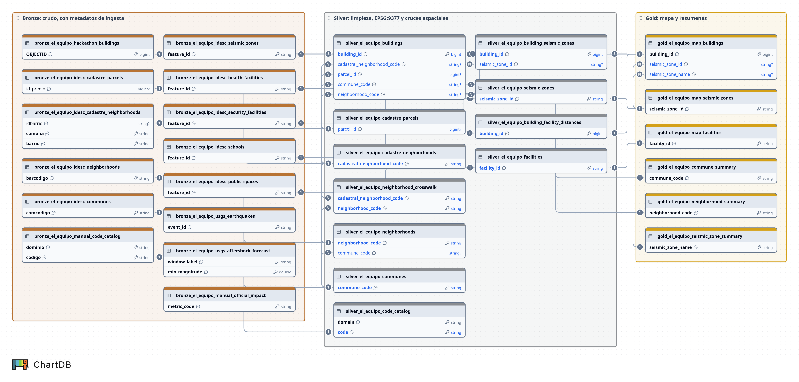
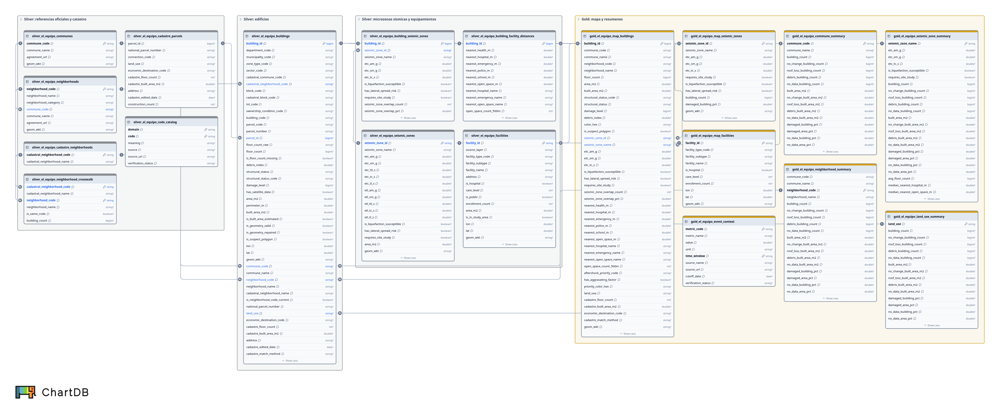

# DataBridge Hack · Sismo de Cali — El Equipo

## El reto

**Pregunta problema:** ¿Qué afectaciones generó el sismo del 10 de agosto en la ciudad de Cali y qué factores contribuyen a reducir el impacto de las réplicas sobre la población, la infraestructura y los servicios urbanos?

El sismo fue de magnitud 7,4 con epicentro en el Chocó ([USGS `us6000tjl2`](https://earthquake.usgs.gov/earthquakes/eventpage/us6000tjl2)). Los datos base son 5.146 edificios de Cali (comunas 3, 9, 10, 17, 18, 19 y 20) con datos catastrales y un estado estructural inferido por análisis satelital (`Estado_Estructural`). La respuesta se construye en Databricks con arquitectura bronze / silver / gold, se enriquece con fuentes externas y se representa en un mapa.

Los dos cruces principales con fuentes externas son la **microzonificación sísmica del IDESC** (en qué tipo de suelo está cada edificio) y los **equipamientos del IDESC** (distancia a hospitales, bomberos y Defensa Civil, policía, colegios y espacios públicos de encuentro). Como contexto se agregan el pronóstico de réplicas del USGS y las cifras oficiales de impacto de la Alcaldía. OpenStreetMap (Overpass) se descartó porque no respondió.

## Arquitectura (medallion)

Todas las tablas viven en `workspace.default` (configurable) con prefijo `el_equipo` y siguen la convención de [`docs/conventions.md`](docs/conventions.md) (identificadores en inglés, textos en español). El detalle de cada tabla y columna está en [`docs/data_dictionary.md`](docs/data_dictionary.md). El job `el_equipo_medallion` las construye en orden.

[](docs/diagrams/img/medallion_overview.png)

*Vista general (llaves y relaciones). Diagramas con todas las columnas: [modelo silver y gold](docs/diagrams/img/silver_gold_model.png) y [fuentes bronze](docs/diagrams/img/bronze_sources.png). Ver [Diagramas de datos](#diagramas-de-datos-chartdb).*

| Capa   | Tabla                                                  | Qué hace                                                                                                                                                                      |
| ------ | ------------------------------------------------------ | ----------------------------------------------------------------------------------------------------------------------------------------------------------------------------- |
| Setup  | volumen `el_equipo`                                    | Guarda crudo (`Datosprediales.json`), externos (`externos/`) y exportes (`export/`)                                                                                           |
| Bronze | `bronze_el_equipo_hackathon_buildings`                 | Una fila por feature, 20 propiedades + `geometry` (texto GeoJSON), tal cual llega con sus nombres originales y sin metadatos (21 columnas)                                    |
| Bronze | `bronze_el_equipo_idesc_communes`, `_idesc_neighborhoods`, `_idesc_cadastre_parcels`, `_idesc_cadastre_neighborhoods` | Capas oficiales del IDESC tal cual (22 comunas, 342 barrios DIVIPOLA 2026, catastro de los edificios, nombres catastrales de barrio), con `_source_url` y `_queried_at` |
| Bronze | `bronze_el_equipo_idesc_seismic_zones`, `_idesc_health_facilities`, `_idesc_security_facilities`, `_idesc_schools`, `_idesc_public_spaces` | Microzonificación sísmica y equipamientos del IDESC tal cual (WFS, con copia de respaldo en el volumen), con `_source_url`, `_queried_at` y `_load_origin` |
| Bronze | `bronze_el_equipo_usgs_earthquakes`, `_usgs_aftershock_forecast`, `_manual_official_impact` | Contexto: sismo principal y 60 réplicas M≥3,5 del USGS, pronóstico oficial de réplicas (P(M≥5) en el próximo mes: 31,5 %) y cifras oficiales de impacto de la Alcaldía (`reference/official_impact.csv`) |
| Bronze | `bronze_el_equipo_manual_code_catalog`                 | Tabla de códigos catastrales curada a mano (`reference/codigos_catastrales.csv`), con `_source_url` y `_queried_at`                                                           |
| Silver | `silver_el_equipo_communes`, `_neighborhoods`          | 22 comunas y 342 barrios oficiales DIVIPOLA 2026 (`neighborhood_code` `CCBB`, comuna, categoría, acuerdo y geometría WKT)                                                      |
| Silver | `silver_el_equipo_cadastre_parcels`, `_cadastre_neighborhoods`, `_code_catalog` | Catastro de los edificios, nombre catastral por código de barrio (auxiliar) y significado de los códigos catastrales                                                        |
| Silver | `silver_el_equipo_buildings`                           | Una fila por edificio: limpieza (trim, vacíos a null), códigos catastrales, pisos válidos, reparación de geometría, área/perímetro en EPSG:9377, centroide, estado y nivel de daño, WKT, comuna y barrio **oficiales por ubicación** y datos del catastro (`national_parcel_number`, `land_use`, `cadastre_floor_count`, `address`) |
| Silver | `silver_el_equipo_neighborhood_crosswalk`              | Código catastral del dataset → barrio oficial por ubicación, con `is_same_code` y `building_count`                                                                            |
| Silver | `silver_el_equipo_seismic_zones`, `_building_seismic_zones` | 16 zonas de microzonificación sísmica del IDESC y la zona de cada edificio (aceleraciones ETC, licuación, estudio particular, traslape con otras zonas)                        |
| Silver | `silver_el_equipo_facilities`, `_building_facility_distances` | Equipamientos del IDESC (salud, bomberos y Defensa Civil, policía, colegios, espacio público de encuentro) y distancia en metros de cada edificio al más cercano de cada tipo |
| Gold   | `gold_el_equipo_map_buildings`                         | Edificios con color, estado, área, bandera de polígono dudoso, zona sísmica, distancias a equipamientos y WKT                                                                 |
| Gold   | `gold_el_equipo_commune_summary`                       | Conteos, área construida y `damaged_building_pct`, `damaged_area_pct`, `no_data_area_pct` por comuna oficial                                                                  |
| Gold   | `gold_el_equipo_neighborhood_summary`                  | Lo mismo por barrio oficial                                                                                                                                                   |
| Gold   | `gold_el_equipo_seismic_zone_summary`                  | Lo mismo por zona de microzonificación sísmica, más pisos promedio y medianas de distancia al hospital y al espacio público                                                   |
| Gold   | `gold_el_equipo_land_use_summary` | Lo mismo por uso del suelo del catastro (`land_use`), con una fila para los edificios sin dato de catastro |
| Gold   | `gold_el_equipo_event_context`                         | Cifras de contexto del evento listas para citar (Alcaldía y USGS), una fila por cifra, con fuente, fecha de corte y estado de verificación; las respuestas usan solo `verified` |
| Export | `export/gold_el_equipo_map_buildings.geojson`          | GeoJSON EPSG:4326 para Kepler.gl / QGIS                                                                                                                                       |

Los notebooks están en `src/`, una carpeta por capa (formato fuente `.py`), y el job en `resources/el_equipo_medallion.job.yml` (serverless, sin clusters):

```
src/
├── setup/    setup_volume.py
├── bronze/   bronze_hackathon_buildings.py, bronze_idesc_references.py, bronze_idesc_seismic_zones.py, bronze_idesc_facilities.py, bronze_usgs_context.py
├── silver/   silver_references.py, silver_buildings.py, silver_neighborhood_crosswalk.py, silver_seismic_zones.py, silver_facilities.py
├── gold/     gold_map_and_summaries.py, gold_event_context.py      (luego: dim_*.py, fact_*.py, vista del mapa)
└── export/   export_geojson.py
```

Los nombres no llevan números: el orden lo define el job con `depends_on`. Para agregar un notebook, créalo en la carpeta de su capa y agrega su tarea en el job. Todo identificador nuevo sigue [`docs/conventions.md`](docs/conventions.md).

## Requisitos

- Databricks CLI ≥ 0.218 (probado con 1.26.0). Instalación: `winget install Databricks.DatabricksCLI` (Windows) o `brew tap databricks/tap && brew install databricks` (macOS). Comprobar con `databricks --version`.
- Ser usuario del workspace del equipo (el dueño te invita).
- Git y acceso a este repositorio.
- `Datosprediales.json` **no** hace falta para trabajar: ya está subido al volumen compartido. Solo quien vuelva a subirlo lo necesita en `data/raw/` (esa carpeta no se sube a git).

## Estado actual

| Paso | Estado |
| ---- | ------ |
| Volumen `workspace.default.el_equipo` con `Datosprediales.json` | Listo |
| `workspace.default.bronze_el_equipo_hackathon_buildings` (5.146 filas × 21 columnas) | Listo |
| Referencias oficiales en el volumen (`/Volumes/workspace/default/el_equipo/externos/referencias/`) | Listo |
| `bronze_idesc_references`, `silver_references`, `silver_buildings` y `silver_neighborhood_crosswalk` | Probados en `dev`; pendiente correrlos en `team` |
| `bronze_idesc_seismic_zones`, `bronze_idesc_facilities`, `bronze_usgs_context`, `silver_seismic_zones` y `silver_facilities` | Escritos; pendiente correrlos en `dev` y `team` |
| Gold y export (con zona sísmica y distancias a equipamientos) | Pendiente de correr |

## Referencias oficiales de códigos

El dataset trae códigos sin significado (COMUNA, BARRIO, ID_PREDIO, TIPO_AVALU, COND...). Se traducen con fuentes oficiales abiertas:

| Fuente | Capa | Uso |
| ------ | ---- | --- |
| IDESC (Alcaldía de Cali), comunas | `dapm:pdt_dpa_comunas` | Nombre de comuna |
| IDESC, barrios y sectores DIVIPOLA (Acuerdo 0636 de 2026) | `dapm:pdt_dpa_barrios_sectores` | Nombre y polígono del barrio |
| IDESC, catastro de terrenos | `catastro:cat_bas_terrenos` | Nombre catastral de barrio, `national_parcel_number`, uso, pisos, área construida, dirección |
| DANE DIVIPOLA / IGAC (Número Predial Nacional) | `reference/codigos_catastrales.csv` | Significado de DEPAPRED, MUNIPRED, TIPO_AVALU, SECTOR y COND (`verification_status` `verified` / `pending_verification`) |

**Barrio y comuna oficiales** (`neighborhood_code`, `neighborhood_name`, `commune_code`, `commune_name` en `silver_el_equipo_buildings`): salen del cruce espacial del centroide con los polígonos DIVIPOLA 2026, que ubica a los 5.146 edificios. Son las columnas para el mapa, los textos y las agregaciones. El código de barrio siempre tiene formato `CCBB` (4 dígitos, sin guion).

**Código catastral:** el dataset usa códigos catastrales de COMUNA+BARRIO (`cadastral_neighborhood_code`), que el Acuerdo 0636 de 2026 cambió u omitió en algunos barrios. `cadastral_neighborhood_name` es el nombre por código catastral (DIVIPOLA si el código existe, si no el del catastro) e `is_neighborhood_code_current` dice si coincide con el oficial. Los 441 edificios cuyo código catastral no coincide son el mismo barrio recodificado en 2026 (ej. `1994` "Pampalinda" → "Pampa Linda"); la traducción completa está en `silver_el_equipo_neighborhood_crosswalk`.

**Catastro** (`cadastre_match_method`): se une por `parcel_id` válido y, si no, por `connection_code` solo cuando es unívoco (`connection`); si hay varias unidades queda `ambiguous_connection` y sin coincidencia `no_match`.

Resultados en `dev`: código catastral vigente 4.703 de 5.144 con código (91,4 %), 2 edificios sin código catastral; catastro por `parcel_id` 1.907 (37 %), por `connection` 2.690 (52 %), `ambiguous_connection` 382 (7 %), `no_match` 167 (3 %).

**Descargar y subir** (la descarga es local; el GeoServer del IDESC responde 403 a ciertos filtros por GET, el script usa POST):
```bash
uv run --no-project --with requests python -I scripts/download_referencias.py
DATABRICKS_CONFIG_PROFILE=el-equipo bash scripts/upload_referencias.sh
```

## Cómo funciona el bundle

Un *Databricks Asset Bundle* describe en archivos de texto lo que debe existir en Databricks (notebooks, jobs, parámetros). La CLI lee esos archivos y lo crea o actualiza en el workspace: nada se configura a mano con clics, todo queda en Git.

| Archivo | Qué define |
| ------- | ---------- |
| `databricks.yml` | Nombre del bundle, **variables** (`catalog`, `schema`, `raw_schema`, `team`, `volume`) y **targets** (`dev`, `team`) |
| `resources/el_equipo_medallion.job.yml` | El job: 14 tareas encadenadas, cada una corre un notebook con las variables como parámetros |
| `src/<capa>/*.py` | Los notebooks. Arman los nombres de tabla con los parámetros (`{catalog}.{schema}.bronze_{team}_hackathon_buildings`), nunca escritos a mano |
| `scripts/upload_data.sh`, `scripts/download_referencias.py`, `scripts/upload_referencias.sh` | Ayudas para subir el crudo y descargar/subir las referencias oficiales (no son parte del bundle) |

El job corre en **serverless** (no declara clusters) y ejecuta en orden:

```
setup_volume ─┬→ bronze_hackathon_buildings ──────────────┐
              ├→ bronze_idesc_references → silver_references ┴→ silver_buildings ─┬→ silver_neighborhood_crosswalk ─┐
              ├→ bronze_idesc_seismic_zones ──────────────────────────────────────┼→ silver_seismic_zones ──────────┼→ gold_map_and_summaries → export_geojson
              ├→ bronze_idesc_facilities ─────────────────────────────────────────┴→ silver_facilities ─────────────┘
              └→ bronze_usgs_context → gold_event_context   (contexto: réplicas, pronóstico y cifras oficiales)
```

**`deploy` vs `run`:**

- `databricks bundle deploy` sube el código a `/Workspace/Users/<tu_usuario>/.bundle/databridge_hack_el_equipo/<target>/` y crea o actualiza el job. **No toca datos.** Respeta `.gitignore`, así que `data/` nunca se sube. Guarda un registro de lo desplegado, por eso la siguiente vez actualiza el job en lugar de duplicarlo.
- `databricks bundle run` ejecuta el job y es lo que crea las tablas. Para correr solo algunas tareas: `--only silver_buildings,gold_map_and_summaries`.

> **Importante:** si editas un notebook directamente en la interfaz de Databricks, ese cambio no está en Git y el siguiente `deploy` lo sobrescribe. Edita en el repositorio y despliega; si pruebas algo en la interfaz, cópialo después al `.py`.

## Flujo colaborativo con bundles

Todo el equipo trabaja en **un mismo workspace**: `https://dbc-240be77b-cf4c.cloud.databricks.com` (el dueño de la cuenta invita a los demás). El host no está en el yml: sale del perfil de la CLI `el-equipo`.

| Target | Dónde escribe las tablas | Quién lo corre |
| ------ | ------------------------ | -------------- |
| `dev` (por defecto) | `workspace.dev_<tu_usuario>`: un esquema por integrante, para no pisarse | Cada integrante, para probar su rama |
| `team` | `workspace.default`: las 3 capas finales que van en la captura | Una sola persona, desde `main` |

El crudo `Datosprediales.json` vive en el volumen compartido `workspace.default.el_equipo` y se sube **una sola vez**; los dos targets lo leen de ahí.

**Una sola vez (el dueño del workspace):**
1. Invitar a los integrantes: Settings → Identity and access → Users → Add user.
2. Crear el volumen compartido y subir el crudo: correr una vez el job (la tarea `setup_volume` crea el volumen) o en SQL `CREATE VOLUME IF NOT EXISTS workspace.default.el_equipo`, y luego:
   ```bash
   DATABRICKS_CONFIG_PROFILE=el-equipo bash scripts/upload_data.sh
   ```

**Cada integrante:**
1. Clonar el repositorio y entrar a la carpeta:
   ```bash
   git clone https://github.com/jdColonia/databridge-hack-sismo-cali.git
   cd databridge-hack-sismo-cali
   ```
2. Autenticarse contra el workspace compartido (abre el navegador):
   ```bash
   databricks auth login --host https://dbc-240be77b-cf4c.cloud.databricks.com --profile el-equipo
   ```
3. Validar, desplegar y correr en su esquema de pruebas (`workspace.dev_<tu_usuario>`; el job se llama `[dev tu_usuario] el_equipo_medallion`):
   ```bash
   databricks bundle validate -p el-equipo
   databricks bundle deploy -t dev -p el-equipo
   databricks bundle run el_equipo_medallion -t dev -p el-equipo
   ```

**Versión final (una persona, con `main` actualizado):**
```bash
databricks bundle deploy -t team -p el-equipo
databricks bundle run el_equipo_medallion -t team -p el-equipo
```

En `mode: development` el job y los notebooks quedan en la carpeta de cada usuario con prefijo `[dev usuario]`, así que nadie pisa los recursos de otro.

### Convenciones de ramas

- `main` siempre debe pasar `bundle validate`.
- Cada integrante trabaja su notebook en una rama corta (`feat/silver-pisos`, `fix/gold-pct`) y abre un PR a `main`.
- Los notebooks son `.py` (formato fuente de Databricks) para que el diff sea legible en el PR.
- Commits en inglés con Conventional Commits. No subir datos ni archivos Excel.

## Diagramas de datos (ChartDB)

ChartDB es la herramienta oficial para diagramas de datos. Los diagramas se guardan como DBML en `docs/diagrams/` y se importan en ChartDB para verlos y exportar la imagen. Guía completa: [`docs/diagrams/README.md`](docs/diagrams/README.md).

| Diagrama | Qué muestra | Imagen | Fuente DBML |
| -------- | ----------- | ------ | ----------- |
| Vista general medallion | Las 31 tablas (14 bronze, 11 silver, 6 gold) con sus llaves y el linaje y los cruces entre capas | [PNG](docs/diagrams/img/medallion_overview.png) | [`medallion_overview.dbml`](docs/diagrams/medallion_overview.dbml) |
| Modelo silver y gold | Las 17 tablas analíticas con todas sus columnas, tipos, llaves y relaciones (edificio, barrio y comuna oficiales, catastro, microzonas, equipamientos, capas del mapa y resúmenes) | [PNG](docs/diagrams/img/silver_gold_model.png) | [`silver_gold_model.dbml`](docs/diagrams/silver_gold_model.dbml) |
| Fuentes bronze | Esquema crudo de cada fuente (hackathon, IDESC, USGS y manual) con sus metadatos de ingesta | [PNG](docs/diagrams/img/bronze_sources.png) | [`bronze_sources.dbml`](docs/diagrams/bronze_sources.dbml) |

[](docs/diagrams/img/silver_gold_model.png)

Los tres DBML salen de [`docs/data_dictionary.md`](docs/data_dictionary.md) y de las relaciones en [`docs/diagrams/relaciones_logicas.json`](docs/diagrams/relaciones_logicas.json). Ninguna relación es una FK declarada en Unity Catalog: son linaje y cruces lógicos.

```bash
npm ci --prefix tools/diagrams                       # una vez
# Desde el diccionario (tablas en diseño o sin correr):
python3 scripts/diagrams/dictionary_to_dbml.py --keys-only --out docs/diagrams/medallion_overview.dbml
python3 scripts/diagrams/dictionary_to_dbml.py --layers silver,gold --out docs/diagrams/silver_gold_model.dbml
python3 scripts/diagrams/dictionary_to_dbml.py --layers bronze --out docs/diagrams/bronze_sources.dbml
# Desde Unity Catalog (tablas ya corridas):
python3 scripts/diagrams/catalog_to_dbml.py --schema dev_<usuario> \
    --relaciones docs/diagrams/relaciones_logicas.json --out docs/diagrams/catalogo_dev.dbml
node tools/diagrams/validate_dbml.mjs docs/diagrams  # valida como lo importa ChartDB
bash scripts/diagrams/chartdb.sh up                  # http://localhost:8080 → PostgreSQL › DBML › Import
```

Todo PR que cambie tablas o columnas actualiza también su `.dbml`.

## Mapa

`map/index.html` es un mapa estático (MapLibre + deck.gl, sin build) que responde: *¿qué afectaciones generó el sismo del 10 de agosto en Cali y qué factores reducen el impacto de las réplicas?*

**Capas (de abajo hacia arriba):**
1. **Microzonas sísmicas**: relleno morado según la aceleración de diseño Sa (g); gris si requiere estudio particular o no tiene dato.
2. **Espacios abiertos seguros**: polígonos verdes.
3. **Edificios** (5.146): coloreados por *prioridad ante réplicas* (por defecto) o por *estado estructural* (selector en la leyenda).
4. **Ayuda cercana**: hospitales y centros de salud (azul), bomberos y Defensa Civil (naranja) y, opcionalmente, colegios.

**Regla de prioridad (criterio del equipo, no cifra oficial):** *Alta* = edificio dañado (pérdida de techo o escombros) con al menos un factor agravante: suelo licuable o que requiere estudio particular, hospital a más de 1 km, o ningún espacio abierto a 500 m. *Media* y *Baja* según el resto de la combinación; *Sin dato* si no hay análisis satelital.

**Cómo correrlo:**

```bash
DATABRICKS_CONFIG_PROFILE=el-equipo bash scripts/download_map_data.sh   # SCHEMA=dev_<usuario> en desarrollo
python -m http.server 8765 --directory map
# abrir http://localhost:8765
```

El botón **Descargar PNG** genera `mapa_el_equipo.png` (mapa + título + leyenda): es la imagen de la diapositiva final.

**Alternativa: Kepler.gl / QGIS**

1. Corre el job completo y descarga `export/gold_el_equipo_map_buildings.geojson` (Catalog > Volumes > `el_equipo` > `export`).
2. **Kepler.gl** (kepler.gl/demo): arrastra el archivo y usa `color_hex` o `priority_color_hex` en Fill Color.
3. **QGIS:** Capa > Añadir capa vectorial; simboliza por categorías con `structural_status_code` (EPSG:4326).

## Entregables del viernes

Correo antes de las 5:00 p. m. del viernes 13, asunto `databridgehack: El Equipo`.

| Entregable                                                                 | Estado |
| -------------------------------------------------------------------------- | ------ |
| Captura de Catalog con las tablas bronze, silver y gold de `el_equipo`     | [ ]    |
| Decisiones en silver y gold (máx. 200 palabras)                            | [ ]    |
| Respuesta a las dos preguntas (máx. 500 palabras)                          | [ ]    |
| Lista de fuentes externas: nombre, enlace y qué aportó                     | [ ]    |
| 3 diapositivas (PowerPoint o PDF): arquitectura, respuesta con datos, mapa | [ ]    |

## Lectura responsable de los datos

- El estado estructural es una **inferencia satelital**, no una inspección en terreno.
- **"Sin cambio aparente" no equivale a "sin daño"**: el satélite no ve daño interno ni fisuras. La propia etiqueta lo menciona ("Daño interno").
- 435 edificios no tienen datos satelitales: se reportan aparte y se excluyen del denominador de los porcentajes, pero la cobertura debe leerse siempre junto al porcentaje.
- El número de pisos es incompleto (`NPISOS = 0` en 1.234 predios); el área construida con 1 piso asumido está marcada como estimada (`is_built_area_estimated`).
- Los polígonos dudosos (área < 5 m² o > 50.000 m²) se conservan con su flag, no se eliminan.
- Priorizar atención con estos datos requiere verificación en campo.
